# Palatinus Tactics

A real-time strategy RPG in the tradition of the late-90s "march your squads
across a liberation map" tactics games, playable in the browser. Squads of up
to five march freely over a 3D campaign map; when two meet, the clash plays
out on its own on a 3D battlefield, decided by who stands in which row.

It is built with TypeScript and Three.js. The map and the battles are drawn
by WebGPU (WebGL2 where the browser lacks it) at the display's own
resolution, with the interface in HTML over them. All art and text in this
repository are original; the figures are painted in code. Ogre Battle 64's
own data and art appear only when extracted locally from your own ROM
([docs/OB64.md](docs/OB64.md)).

| | |
|---|---|
| 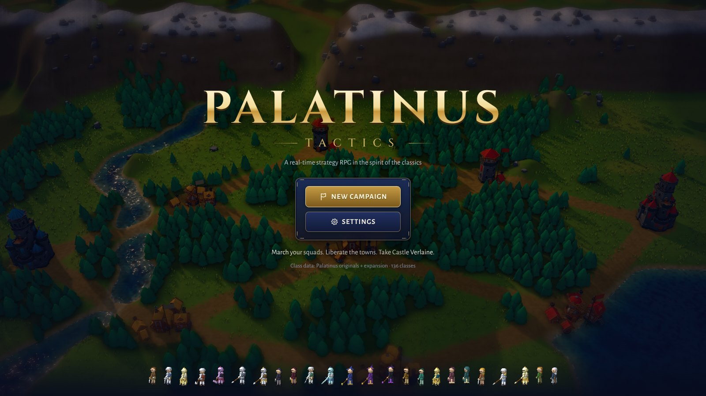 | 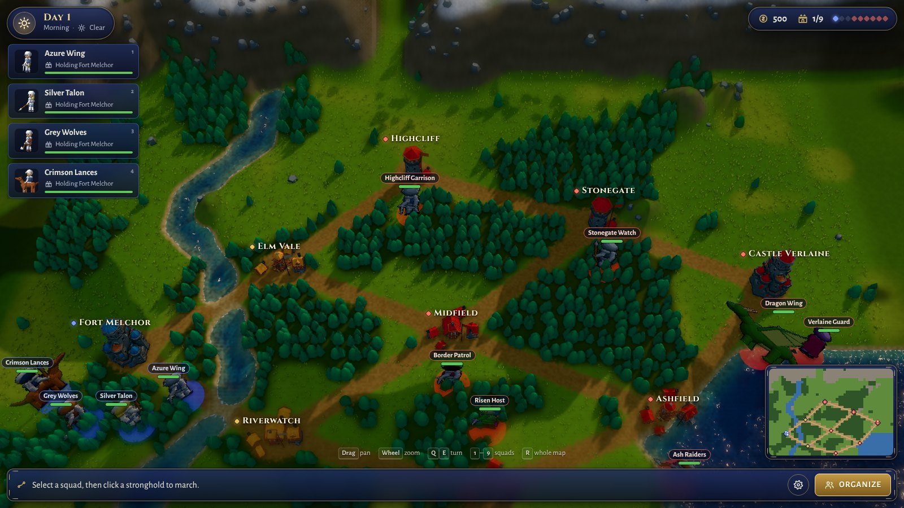 |
| 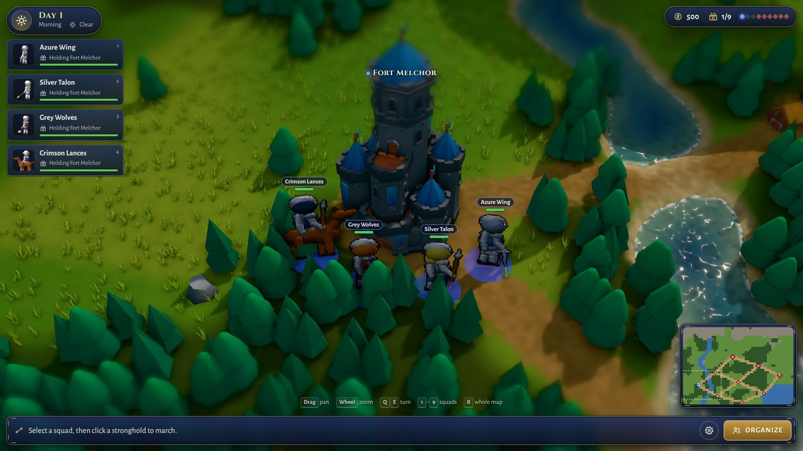 | 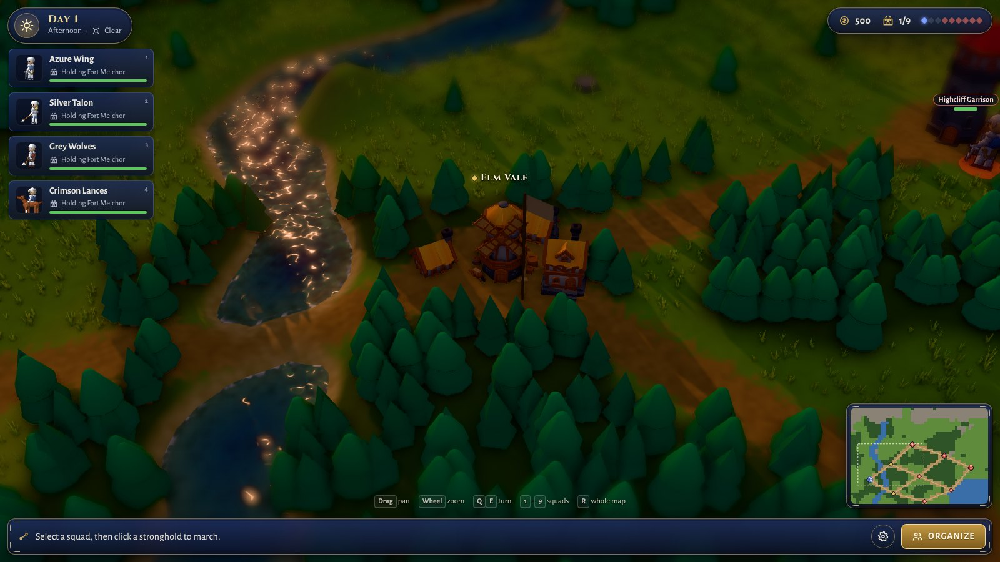 |
| 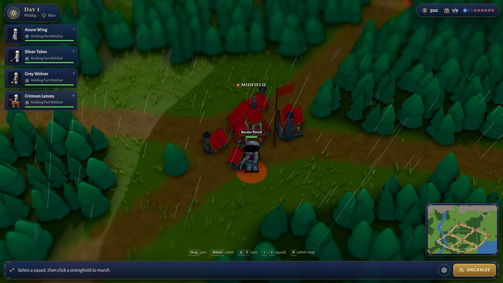 | 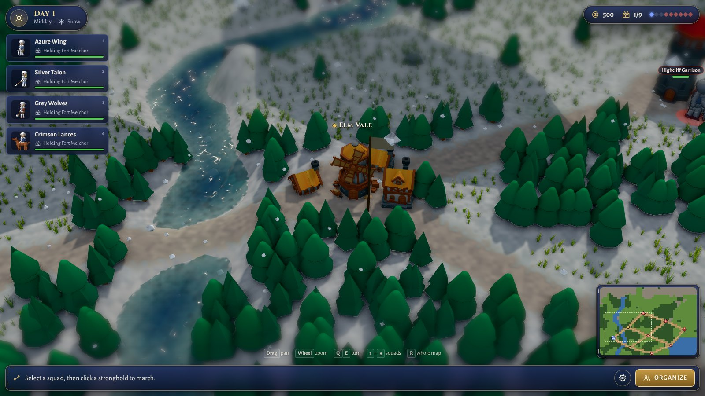 |
| 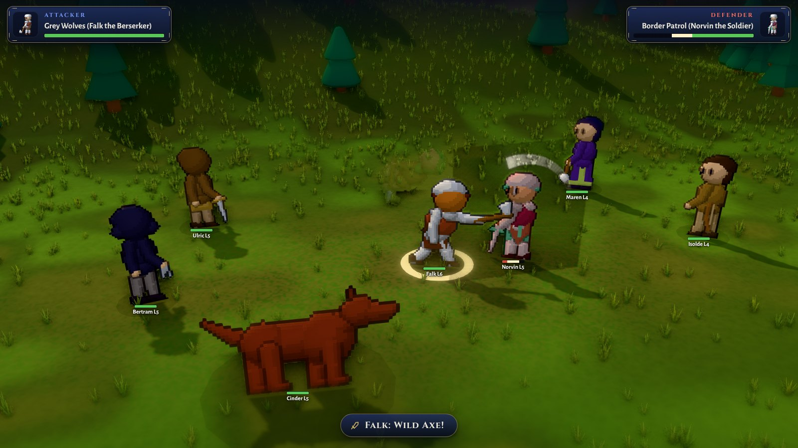 | 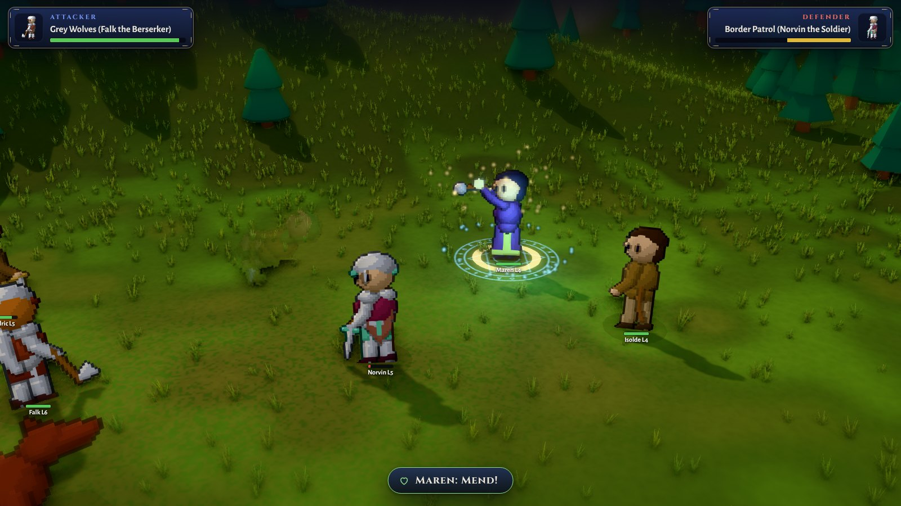 |
| 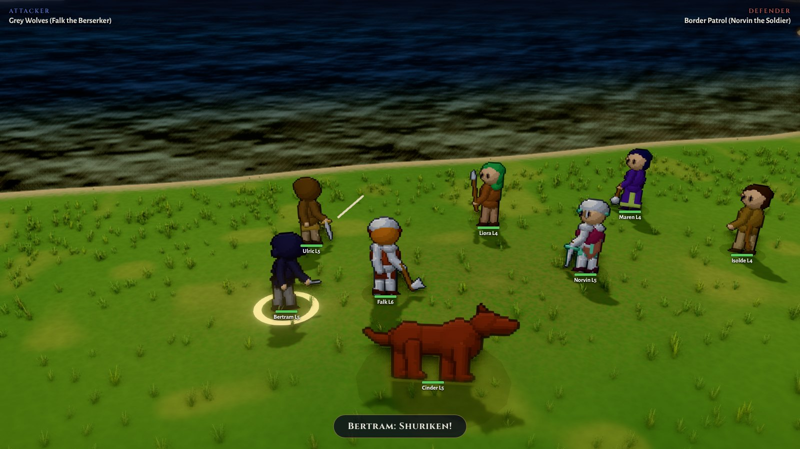 | 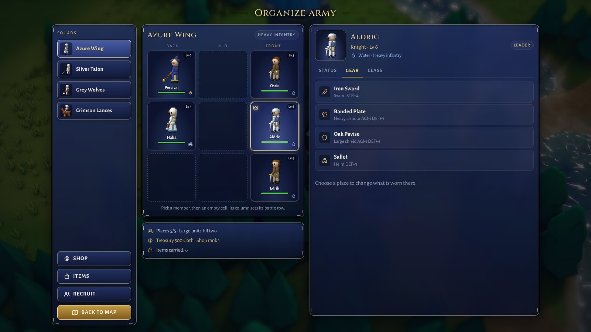 |
| 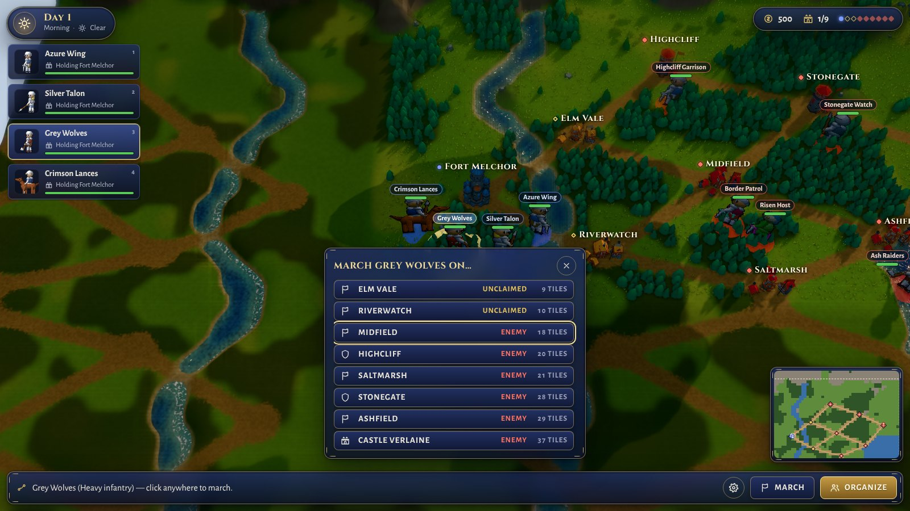 | 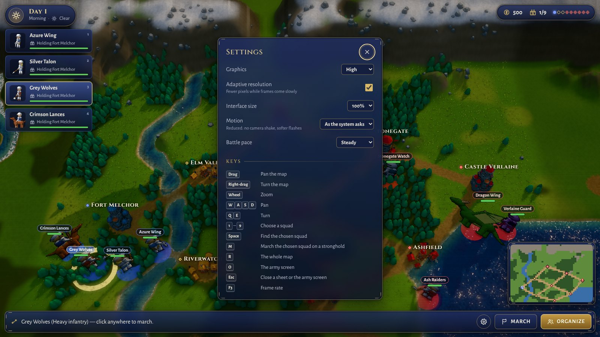 |

These show the built-in data at the High preset.

## Running it

```bash
npm install
npm run dev      # http://localhost:5173
npm test         # 335 unit tests (318 without extracted ROM data)
npm run build    # type-check + production bundle into dist/
npm run e2e      # an automated playthrough in a real browser (needs npm run dev)
npm run perf     # boot, frame times and GPU memory over a run of battles (needs npm run dev)
```

It needs a browser with WebGPU or WebGL2: any current desktop Chrome, Edge,
Firefox or Safari.

## How to play

You hold Fort Melchor, the keep in the west. The enemy holds Castle Verlaine
in the east and the strongholds between. **Take Castle Verlaine to win; lose
Fort Melchor and the campaign is over.** Strongholds you hold pay Goth (gold)
every day; spend it on gear and recruits.

**Giving orders.** Choose a squad, then send it anywhere: squads march in a
straight line to any point, over any ground, and the ground decides how fast
they go. A squad that halts at a stronghold takes it. When two hostile squads
meet, they fight.

| | Mouse | Keyboard |
|---|---|---|
| Choose a squad | Click it, or its card on the left | **1** – **9** |
| March | Click anywhere on the map (clicks near a stronghold snap onto it) | **M**: a list of strongholds, nearest first; arrows and **Enter** |
| Look around | Drag to pan, wheel to zoom, right-drag to turn; click the small map to look there | **W A S D** or arrows to pan, **Q E** to turn, **Space** to find the chosen squad, **R** for the whole map |
| The army screen | *Organize* | **O**, and **Esc** to close |
| Settings | The gear button | Tab to it, **Enter** |
| Frame rate | | **F3** |

**Battles** play themselves. What you decide is who fights, and where each
member stands: on the army screen, a member's *column* on the 3x3 grid sets
their battle row (front, middle or back), and their row sets which attack
they make and how often. A knight in front swings twice; an archer gains a
third shot from the back; clerics heal only from the rear. The side that
loses the smaller share of its strength wins and drives the other back.

## What's in the game

**The campaign map.** A 3D land of hills, a river, woods and a lake, with
roads between nine strongholds: castles, forts and towns from the KayKit
medieval pack, in their owners' colours. Day turns to night every six
campaign days, and the weather (clear, cloud, rain, snow, mist) changes
every three, without touching the campaign. The map is grown from the very
terrain grid that marching is charged on, so what you see is exactly what a
march costs. Roads are quickest; forest, hills and water slow a march by how
much depends on the squad's make-up: light troops shrug off forest and hills,
cavalry hates them, fliers ignore the ground. Enemy squads strike at the
nearest of your holdings within reach; a routed squad regroups at the keep.

**The map's instruments.**
* Top left: the day, the hour and the weather.
* Top right: the treasury, and the strongholds held.
* Down the left: a card for each of your squads, with its leader's face, its
  orders ("Marching on Elm Vale", "Holding Fort Melchor", "Regrouping", "In
  battle") and its strength.
* A small map of the whole realm.

**Battles** are staged on a battlefield made like the map, shaped by where
the squads met (a meadow, a road, a forest clearing, a mountain pass, a
shore) and lit by the hour and weather they met in. The squads march on and
the camera frames each action:
* fighters run in and strike;
* archers loose arrows;
* casters gather light in a magic circle and cast their element's spell.

Blows land with weight: a held moment, a shake, the light of the blow on the
figures. Each side's card heads the field, and strength bars drain as blows
land.

**The army.** The army screen arranges each squad's formation and shows each
member's sheet in three tabs:
* **Status:** stats with gear bonuses, alignment, Luck, resistances and each
  row's attack.
* **Gear:** the four places, and what to put in them.
* **Class:** every class change and what it asks.

*Shop*, *Items* and *Recruit* open beside it.

**Classes.** 36 original classes along a male line (Fighter → Knight,
Berserker, Ninja, Wizard…), a female line (Amazon → Valkyrie, Archer,
Cleric, Witch…) and monsters. A class change is gated on level, stats and
alignment, and alignment drifts with how a unit fights: felling stronger foes
raises it, preying on the weak lowers it. So how you fight decides which
classes open up. A class expansion adds 100 more from two other games (see
below).

**Equipment and items.** Every unit has four places: a weapon, body armour,
an off hand and a head. Gear adds to stats and resistances, and two-handed
weapons leave no hand for a shield. Elemental weapons strike half with their
element, and slaying weapons strike dragons or the undead half again as hard.
Supplies heal, revive or carry a squad home; relics raise a stat for good;
key items open the class changes that call for them. The shop's stock grows
with the strongholds you hold. Great beasts (dragons, golems, hellhounds)
stand in two cells and fill two of a squad's five places.

## Graphics and performance

Every frame passes through ambient occlusion, bloom, tone mapping, a
vignette and edge smoothing. Four presets trade sharpness and effects against
frame rate; the game picks one to suit the machine, and Settings changes it.

| | Low | Medium | High | Ultra |
|---|---|---|---|---|
| Most pixels per CSS pixel | 1 | 1.5 | 2 | 2.5 |
| Ambient occlusion, SMAA | no | no | yes | yes |
| Bloom, tilt-shift | no | yes | yes | yes |
| Sun shadows (texels) | none | 1024 | 2048 | 4096 |
| Grass tufts per meadow tile | none | 6 | 12 | 20 |
| Raindrops / snowflakes | 1,500 | 4,000 | 8,000 | 14,000 |
| Lighting | plain diffuse | physically based | physically based | physically based |

* **Adaptive resolution** (on unless turned off in Settings): while frames
  come slowly, the view draws fewer pixels, down to half, and more again as
  they come easily. The interface is HTML and stays sharp throughout.
* **A still map costs nothing:** under the army screen, the map is drawn once
  and left showing.
* **Battles prepare their shaders before the field is shown**, in parallel
  where the browser can, rather than stalling on the first frame.
* **Nothing is left behind:** every battle's render targets, textures and
  shapes are freed when it closes. `npm run perf` checks that the GPU's
  memory holds nearly level over a run of battles.
* **F3** (or `?fps`) shows the frame rate, backend, preset, resolution scale
  and draw calls.
* `?quality=low` … `ultra` picks a preset for one visit, exactly (adaptive
  resolution is then off); `?webgl` forces the WebGL2 path. Should a WebGPU
  device be lost, the game reloads itself on WebGL2.

## Accessibility and comfort

* **Everything by keyboard,** including march orders (**M**). Focus is always
  visible. Sheets and dialogs keep the keyboard while open and hand it back to
  what opened them. The army screen keeps your place as it redraws after each
  change.
* **Settings** (the gear button on the title or the map):
  * *Interface size:* 85% to 130%; the army screen still fits the window.
  * *Motion:* as the system asks (`prefers-reduced-motion`), reduced, or
    full. Reduced stills the camera's shake and push, softens flashes of
    light, and cuts the interface's animations short.
  * *Battle pace:* steady, brisk (1.5×) or swift (2×). This changes only how
    fast a battle is shown, never its outcome.
  * *Adaptive resolution,* and the graphics preset.
* **Readable:** every text colour is tested at 4.5 to 1 or better against its
  panel over anything the view may show behind it (WCAG AA). Who holds a
  stronghold shows in shape as well as colour: yours round, the enemy's a
  diamond, unclaimed hollow.
* **Screen readers:** the interface is plain HTML with named controls. Battle
  commentary, the map's orders line and notices are announced, and the 3D
  view is marked as a picture.

## The class expansion

On top of whichever dataset is loaded, Palatinus grafts on the classes of two
other games, translated into Ogre Battle 64's model:

| Source | What it gives | Classes added (originals / OB64) |
|---|---|---|
| *Ogre Battle: The March of the Black Queen* (SNES), from [the RPGClassics shrine](https://shrines.rpgclassics.com/snes/ogrebattle/classes.shtml) | HP, STR, AGI and INT as base + growth; six affinities; starting alignment and luck; two row attacks with hit counts; each class's route (from which class, at what level, in what alignment window, or by which item) | 53 / 39 |
| *Symphony of War: The Nephilim Saga*, from [the Symphony of War wiki](https://symphonyofwar.wiki.gg) | Low / Med / High ratings for each stat's base and growth; unit type (heavy or light infantry, cavalry, flier, caster, healer); the stat a promotion asks for; which classes each upgrades into | 47 / 45 |

That is 136 classes on the originals and 190 on Ogre Battle 64's data, with
classes now reaching a fourth tier (Dragon Master, Lich, the Dragon Riders,
the Dark Mage). Gunpowder classes are left out by design. Named characters
are not classes and are not taken.

**How a class is translated.** Neither game uses Ogre Battle 64's seven stats
or its scale, so stats carry over *relatively*. A SNES class's standing
against the other SNES classes of its tier becomes the same standing against
the active dataset's classes of that tier. A Symphony of War rating does the
same, with Med as the tier average.

VIT, MEN and DEX, which neither game has, come from the nearest things each
does have:
* for the SNES game: HP and physical affinity, INT and elemental affinity,
  AGI and STR;
* for Symphony of War: armour, magic and skill.

SNES affinities become resistances; its undead, immune to all but holy power,
stay that way. Attacks are named for what they are: *Jihad* is Virtue magic
that hits everyone, and a Symphony of War Fire Mage throws Fire at a whole
row. Large monsters and Colossal dragons fill two places.

**Merging.** When a class already exists (Ogre Battle 64's Knight, the
originals' Wizard), the existing one wins untouched and the other game only
adds its routes into it. So a SNES Beast Man can become Ogre Battle 64's own
Beast Master, and Symphony of War's Soldier and Cavalier both become Knights.
Its generic recruit, the Fighter, is Ogre Battle 64's Fighter *and* Amazon,
so its whole tree opens to women too. On Ogre Battle 64's data, the new
routes are stat-gated by the same rule as the game's own. Routes that
consume an item (the SNES Werewolf's *Virus*, the Lich's *Undead Ring*) open
once the item is in hand.

**Squad types.** How a squad marches follows from its make-up, by Symphony of
War's rules. Each class is slow (casters, healers), heavy, light, heavy or
light cavalry, or a flier. A squad is:
* *flying* when fliers are at least as many as the rest, with no horses or
  grounded giants among them;
* *cavalry* when horses outnumber the infantry;
* *slow* when half are casters;
* *light* when light troops outnumber the rest by one;
* *heavy* otherwise.

The scraped facts live in `src/data/expansion/*.json`. They hold numbers,
names and routes only; none of either site's writing is copied, and the
descriptions in game are Palatinus's own. `npm run scrape:expansion`
regenerates them, pausing between requests.

## Ogre Battle 64's own data

If you own Ogre Battle 64 (USA, Rev A), `npm run extract:ob64 -- your.z64`
reads its class, attack and item tables and its unit sprites into
`public/ob64/`, and the game then plays on them: 106 of the game's classes
plus the expansion, 277 pieces of equipment, and every unit in the game's own
animated art. **That folder is git-ignored, and every build leaves it out.**
What comes over, how faithfully, and how the sprites are stored:
[docs/OB64.md](docs/OB64.md).

Without a ROM, Palatinus runs on its own catalogue: 36 classes and 164 items
(145 pieces of gear, 7 supplies, 12 relics) with original names, in the same
shape.

## The art

**The painted figures** (`src/art/`). Every class has its own figure,
painted in code when it is first needed, in the HD-2D manner: pixel art about
53 pixels tall that the 3D scene lights as it lights the land.
* Each part is a solid shape on the pixel grid that records which way it
  faces, so one drawing yields both a picture and a normal map.
* People are dressed from their class's rules: the weapon it may carry,
  plate, mail, leather or robes by its armour, a helm, hood or hat, a shield
  where a hand is free, a cape at the higher tiers.
* Hounds, dragons, golems, ghosts and sea creatures have rigs of their own,
  and mounted classes ride a horse whose coat the class chooses.
* Six animations are eased between key poses: at ease, marching, attacking
  (a swing, a thrust or a shot), casting, flinching and falling.

`tools/art-preview.html?classes=knight,wyvern&anim=attack&scale=4` shows
every frame while the dev server runs (`&normals` for the normal maps).

**The land** (`src/gfx3d/landscape.ts`, `atmosphere.ts`, `sky.ts`).
* The ground is painted in the GPU: meadow greens, a darker floor under the
  woods, worn earth on the roads, rock and snow on the heights, sand at the
  water's edge.
* The water knows its depth: green in the shallows, deep blue further out,
  with waves that catch the light and froth along the shores.
* The wind sways the woods and the grass.
* The sun casts shadows, and clouds' shadows drift over the land.
* A tilt-shift makes the land look like a model of itself.

**The effects** (`src/gfx3d/vfx.ts`, `spells.ts`) come from one pool of
glowing particles and a few textures drawn in code, and light the figures
about them. `tools/fx-preview.html` stages each one, a step at a time.

**The interface** (`src/ui/`): translucent night-blue panels with gilded
corners, set in Cinzel and Alegreya Sans, with icons drawn in code as SVG.
`tools/ui-preview.html` shows every piece.

## Layout

The code is laid out in three layers: rules, pictures and screens. How they
fit together, and why: [docs/ARCHITECTURE.md](docs/ARCHITECTURE.md).

```
src/
  core/         the rules: pure functions over the campaign state, no rendering
    types.ts       shared types, grid/row mapping, elements and resistances
    character.ts   lineage, stats and level-ups, class change, alignment
    items.ts       gear and its rules, effective stats, supplies, shop, spoils
    camp.ts        rest at strongholds, the fallen rising at the keep
    squad.ts       formation grid, march speed, squad types
    battle.ts      the engagement simulator; returns an event log to play back
    terrain.ts     the terrain grid, roads, per-tile movement costs
    movement.ts    free marching, stronghold occupancy, retreat
    state.ts       the campaign state and starting scenario
  data/         the built-in classes and items; registry.ts, the active dataset
  expansion/    the two other games' classes, translated onto the active dataset
  ob64/         reading Ogre Battle 64's tables and sprites from a ROM
  art/          the painted figures: raster, rigs, looks, animations, sheets
  gfx3d/        the 3D stages: the map (world.ts), battles (stage.ts, arena.ts),
                effects (spells.ts, vfx.ts), the land and sky, figures, layout
  gfx/          unit pictures for menus, label decluttering, strength bars
  render/
    engine.ts      the one renderer (WebGPU or WebGL2) and its finishing chain
    quality.ts     the presets, the first guess for a machine, the kept choices
    governor.ts    adaptive resolution
  app/          the shell: one base screen and one over it, the frame loop
  screens/      title, map (+ mapHud.ts, its instruments), battle, organize, settings
  ui/           dom.ts, icons.ts, comfort.ts (interface size, motion, pace), styles.css
  main.ts       boot
tools/          extract-ob64, scrape-expansion, pack-models; art, fx and ui previews
e2e/            the automated playthrough (playthrough.mjs) and the performance probe (perf.mjs)
docs/           ARCHITECTURE.md, TESTING.md, OB64.md, screenshots
```

## Tests

`npm test` runs 335 tests (318 without extracted ROM data), mostly over the
rules, in Node without a browser:
* battles, marching and terrain, the class tree, the expansion, equipment and
  items;
* Ogre Battle 64's decoder, on a synthetic cartridge;
* the painted figures, the 3D map's shape and the battle's layout;
* the interface's colours (WCAG AA contrast) and adaptive resolution.

The suite is mutation-checked: code was broken on purpose, and each break
that survived got a test of its own.

`npm run e2e` plays the game in a real browser through its interface, and
`npm run perf` measures it. Details: [docs/TESTING.md](docs/TESTING.md).

## Balance knobs

| What | Where |
|---|---|
| Class stats, growths, row attacks, promotion requirements | `src/data/classes.ts` |
| Damage and healing formulas | `src/core/battle.ts` |
| March speeds and squad-type rules | `src/core/squad.ts` |
| Terrain costs and the road bonus | `TERRAIN_SPEED` and `MARCH_TERRAIN` in `src/core/terrain.ts` |
| Capture and snap radii | `src/core/movement.ts` |
| The map, the landscape's shapes, the river | `src/core/state.ts`; `baseTerrainAt` and `riverX` in `src/core/terrain.ts` |
| Translation weights for the expansion | `src/expansion/translate.ts` |
| Recruit costs | `recruitCost` in `src/screens/organize.ts` |
| Built-in items; OB64 supply effects | `src/data/items.ts`; `CONSUMABLE_EFFECT` in `src/ob64/convert.ts` |
| Slaying bonus, shop ranks, spoils, resale | `src/core/items.ts` |
| Rest and revival | `src/core/camp.ts` |
| Battle spacing and camera shots | `ROW_SHEAR`, `DIAGONAL`, `WIDE` in `src/gfx3d/layout.ts` |
| Battle timing | `MARCH_MS`, `RUN_MS`, `STRIKE_GAP`, `AFTER_MS` in `src/screens/battle.ts` |
| Map camera limits and opening view | `VIEW_LIMITS`, `OVERVIEW` in `src/gfx3d/worldMap.ts` |
| Figures' size on the map | `FIGURE_HEIGHT` in `src/gfx3d/mapFigures.ts`; `FIGURE_FULL_AT` in `src/gfx3d/worldMap.ts` |
| OB64 sprites' size and the beasts' enlargement | `PIXELS_PER_UNIT`, `LARGE_SCALE` in `src/gfx3d/ob64Sprites.ts` |
| Presets; adaptive resolution's thresholds | `src/render/quality.ts`; `src/render/governor.ts` |

## Credits

Fonts and the KayKit models are listed with their licences in
[CREDITS.md](CREDITS.md).
